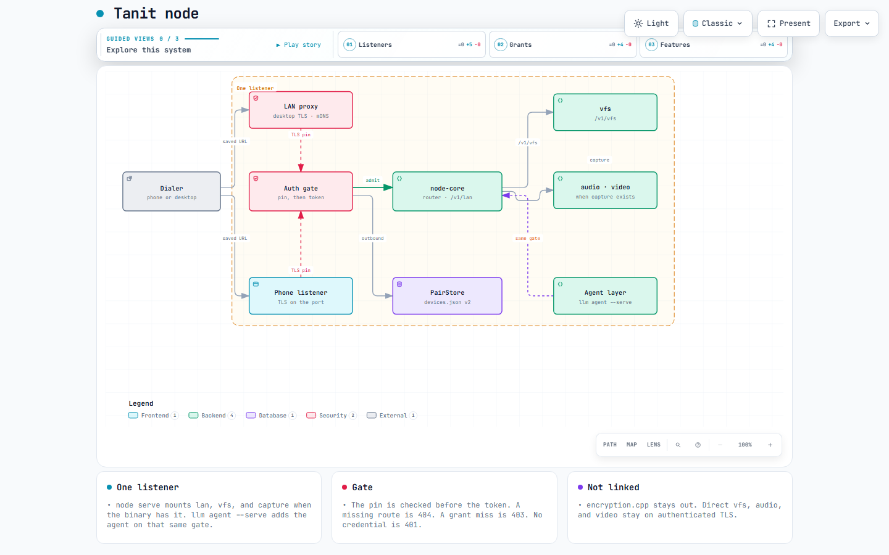
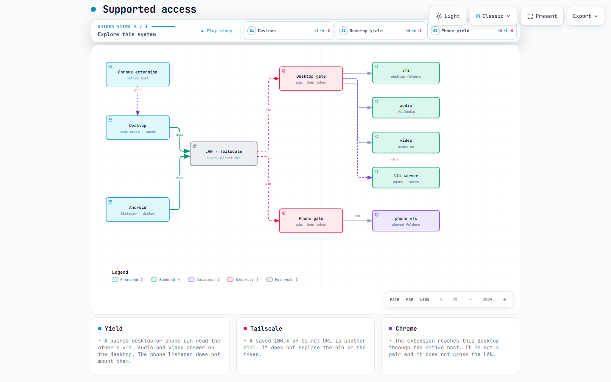

# pm-server

Tanit node. `pm-server-lib` is the `/v1/vfs` routes and the paired-peer listener. Desktop routes, mDNS, and the LAN proxy stay in this tree and are compiled by the host. The phone compiles the portable files plus its lifecycle and transport glue.

Package triangle (settled): **server** owns complete node connectivity —
PeerBook, dial, grants, `/v1/vfs` client **and** routes — and registers a
VFS backend into [vfs.cpp](../vfs.cpp/README.md). It does not own the transfer
engine. Plan: [docs/vfs-refactor.md](../../docs/vfs-refactor.md).

Siblings: [commons.cpp](../commons.cpp/README.md) (primitives, optional
`pm-commons-net`), [vfs.cpp](../vfs.cpp/README.md) (jail + upcoming client
runtime), [llm.cpp](../llm.cpp/README.md) (agent routes on the desktop
listener). [encryption.cpp](../encryption.cpp/README.md) is not linked. Its
`pm::host::Device` and `pm-encryption server` are a test host, not this process.

## Modules

The target source groups are [node-core](src/node-core/README.md),
[node-transports](src/node-transports/README.md),
[node-features](src/node-features/README.md), and
[node-e2ee](src/node-e2ee/README.md). Translation units live there. Public headers stay `pm/server` and `pm/node`.

| Module | Where | Who compiles it |
| --- | --- | --- |
| VFS routes | [vfs.cpp](src/node-features/vfs/vfs.cpp), [vfs.hpp](src/base/include/pm/server/vfs.hpp) | `pm-server-lib`, and the phone image |
| Route flags | [features.hpp](src/base/include/pm/server/features.hpp) | header only. Phone turns llm, tools, and host off |
| Node options | [options.hpp](src/base/include/pm/server/options.hpp) | header only. Listener limits, features, LAN, serve-key capabilities |
| Desktop seams | [desktop.hpp](src/tanit-node/include/pm/node/desktop.hpp) | header only. Principals, route policies, router registration, optional agent layer |
| Bearer parse | [secret.hpp](src/base/include/pm/server/secret.hpp) | header only |
| Pair file | [pair_store.cpp](src/node-core/pair/pair_store.cpp), [pair_store.hpp](src/tanit-node/include/lan/pair_store.hpp) | `pm-server-lib`, and the phone image. Grant, trust, and the token hash |
| Paired-peer listener | [listener.cpp](src/node-core/lifecycle/listener.cpp), [peer_listener.hpp](src/tanit-node/include/pm/node/peer_listener.hpp) | `pm-server-lib`, and the phone image |
| Shared folders | [shared_folder.hpp](src/base/include/pm/server/shared_folder.hpp) | header only. Parsed bookmark rows become mount roots. The host reads the settings store |
| Desktop listener | [node.cpp](src/node-features/agent/node.cpp) and [node_llm](src/node-features/agent/node_llm.cpp), [node_chat](src/node-features/agent/node_chat.cpp), [node_realtime](src/node-features/agent/node_realtime.cpp), [node_audio](src/node-features/audio/node_audio.cpp), [node_video](src/node-features/video/node_video.cpp), [node_host](src/node-features/agent/node_host.cpp), [node_lan](src/node-features/agent/node_lan.cpp) | host, via `pm_llm_sources(cli)`. Includes the agent and settings |
| LAN proxy | [lan_win.cpp](src/node-transports/desktop/lan_win.cpp) / [lan_stub.cpp](src/node-transports/desktop/lan_stub.cpp), [lan_qr.cpp](src/node-transports/desktop/lan_qr.cpp) | `pm_server_add_lan` |
| mDNS | [mdns_win.cpp](src/node-transports/desktop/mdns_win.cpp) / [mdns_stub.cpp](src/node-transports/desktop/mdns_stub.cpp) | `pm_server_add_mdns` |
| Phone glue | [node.cpp](src/node-core/lifecycle/node.cpp), [vfs_listener.cpp](src/node-transports/phone/vfs_listener.cpp), [phone_vfs.hpp](src/tanit-node/include/pm/node/phone_vfs.hpp) | Android `tanit_node_phone` only |
| Host wiring | [host.cmake](cmake/host.cmake) | included by the repo root |
| Source ownership | [sources.cmake](cmake/sources.cmake) | canonical portable, transport, agent, bookmark, and phone groups while files move |
| Version CLI | [cli/main.cpp](cli/main.cpp) | top-level `pm-server` only. The host does not build it |

Shared folders are [shared_folder.hpp](src/base/include/pm/server/shared_folder.hpp). The listener entry for both hosts is [node.hpp](src/tanit-node/include/pm/node/node.hpp).

## Integration

```cmake
if(NOT TARGET pm-server-lib)
  add_subdirectory(${CMAKE_CURRENT_SOURCE_DIR}/packages/server.cpp
                   ${CMAKE_CURRENT_BINARY_DIR}/pm-server-lib EXCLUDE_FROM_ALL)
endif()
target_link_libraries(${HOST_TARGET} PRIVATE pm-server-lib)
```

`pm_server_add_lan` and `pm_server_add_mdns` add the platform files. The phone image compiles the list from `pm_server_phone_sources` itself, so those two `.cpp` files are not also inside `pm-server-lib` on Android.

## Architecture

Interactive copy: [docs/architecture](docs/architecture/architecture.md). Background is [docs/tanit-mesh.md](./docs/tanit-mesh.md).

`node serve` and the phone listener share one gate. `llm agent --serve` mounts the agent on that gate. A feature that is off is not registered. `encryption.cpp` is not linked.



The pin is checked before the token. `PairStore` version 2 is the pair file. vfs calls [vfs.cpp](../vfs.cpp/README.md). audio and video call [audio.cpp](../audio.cpp/README.md) and video.cpp when those captures are compiled in.

A paired desktop or phone can read the other's vfs over LAN or a saved Tailscale URL. Audio and video answer on the desktop listener. The phone listener serves folders only. Chrome stays on the local native host.



Older notes, in Mermaid:

| File | Shows |
| --- | --- |
| [docs/node-today.md](docs/node-today.md) | Both listeners as they compile now: build targets, types, the two gates, pairing, and a phone folder read |
| [docs/node-refactor.md](docs/node-refactor.md) | Target folders: `node-core`, `node-transports`, `node-features`, `node-e2ee`. The router and the gate |
| [docs/node-impl.md](docs/node-impl.md) | The commits. One commit leaves `tanit`, `tanit-cli`, and `test:vfs-phone` green |
| [docs/encryption-seams.md](docs/encryption-seams.md) | Snapshot of a proposed link. Tanit-mesh section 7 supersedes it: the library stays unlinked |

## Next

What is still open is [docs/tanit-mesh.md](./docs/tanit-mesh.md) section 11.

- E2EE is only for a file a relay or another store will hold. Direct vfs, audio, and video stay on authenticated TLS. `pm-server-lib` and `node serve` do not link [encryption.cpp](../encryption.cpp/README.md).
- The tray and the built-in GUI still start a node that can answer 401 and `invalid LAN hop`. `node serve` listens on 8092, TLS 8093. The agent stays on 8090. A hop this process did not write is 400. No serve key and no pair token is 401.
- Audio and video are route groups beside vfs, including when the agent is off. An in-process LLM is a local principal, not a paired device. Paths, strings, and logging stay in [commons.cpp](../commons.cpp/README.md).
