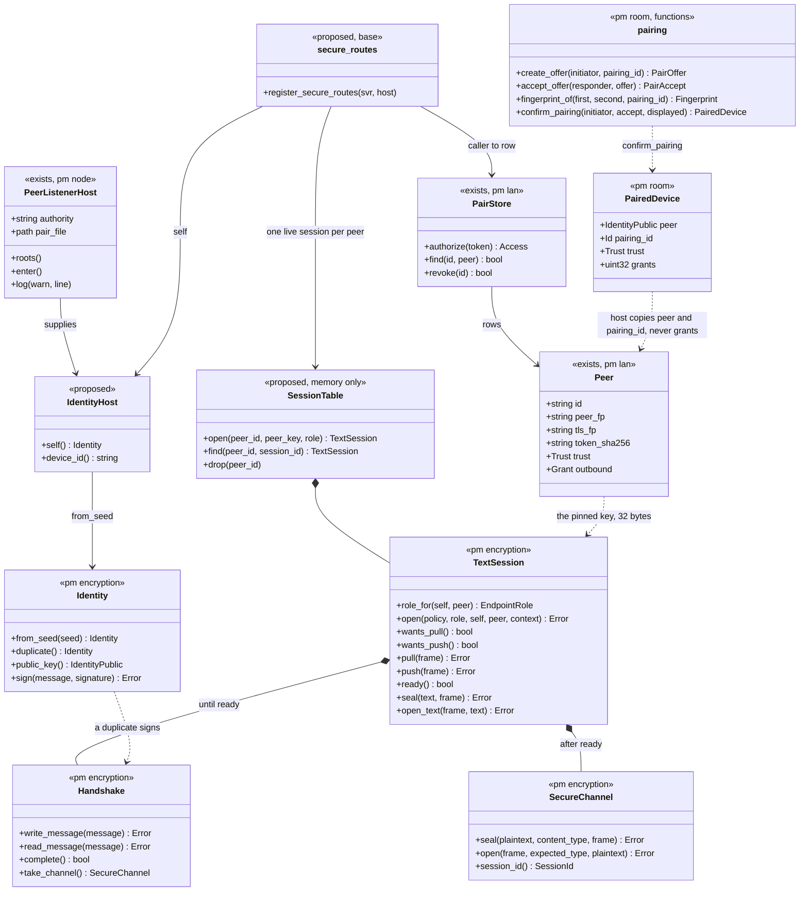
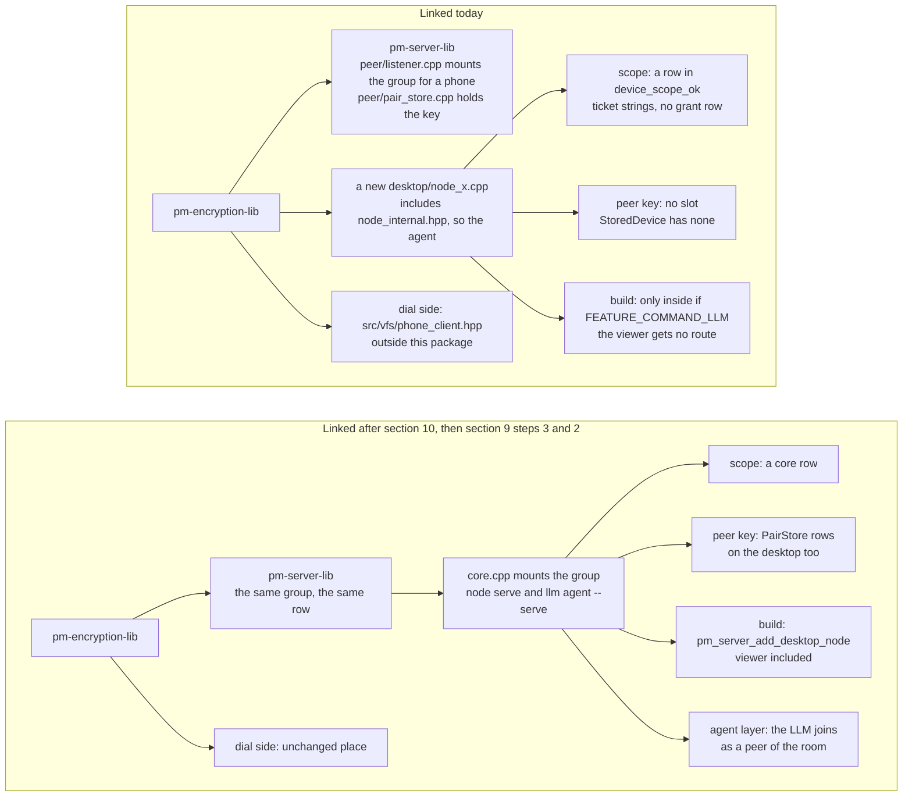
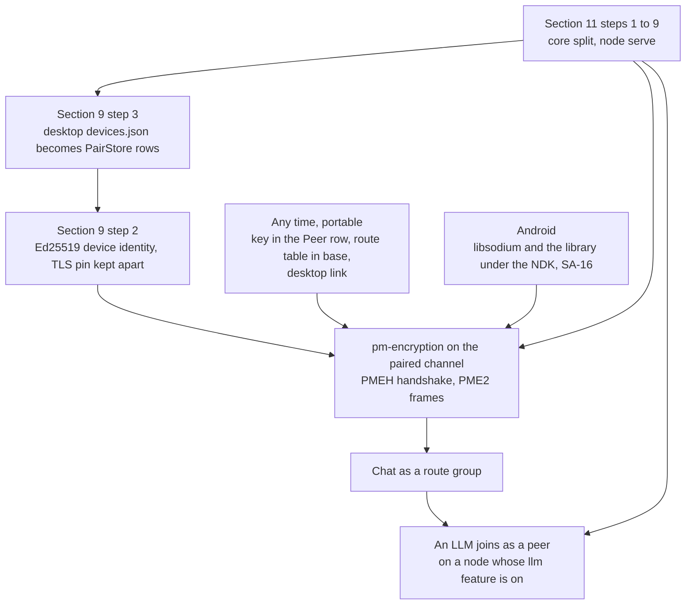
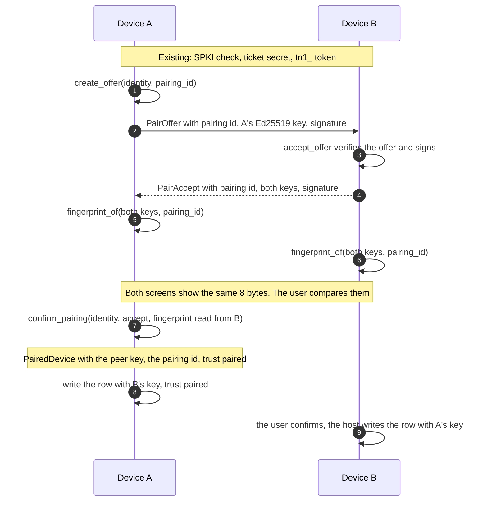
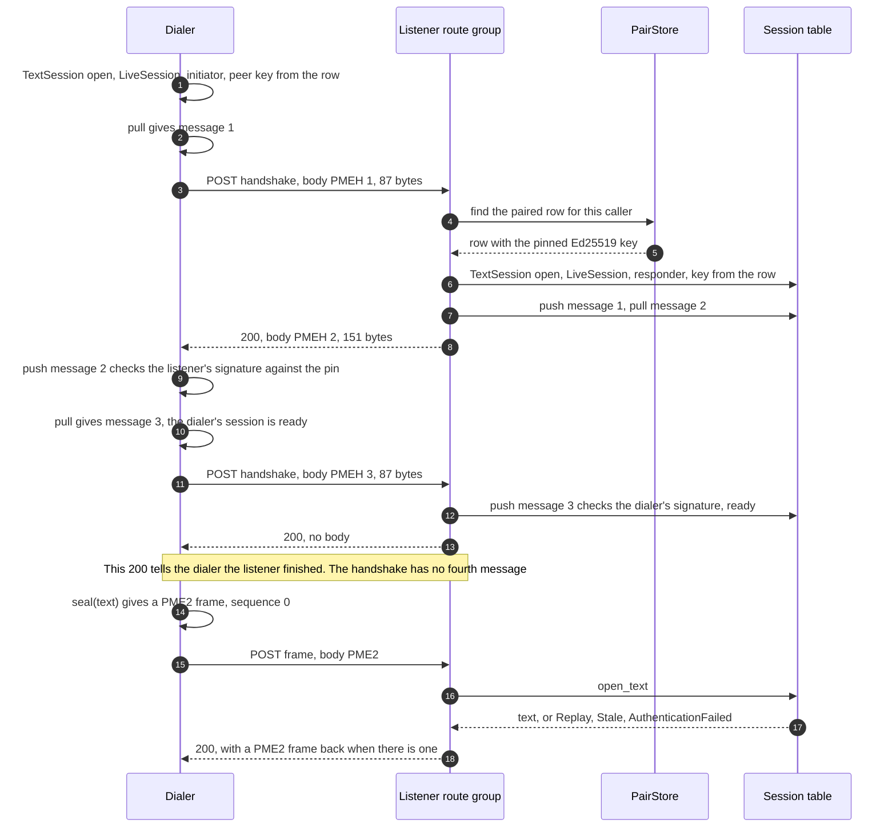
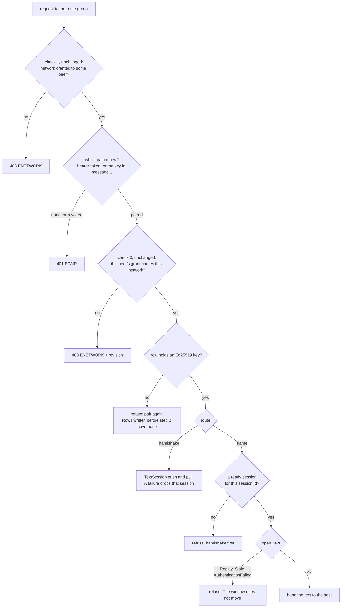

# Where encryption.cpp attaches

**Date:** 2026-11-19  
**Status:** snapshot from before the architecture pass. Nothing links, and [tanit-mesh.md](../../../docs/tanit-mesh.md) section 7 keeps it that way: `pm-server-lib` does not link `pm-encryption-lib`. The handshake-over-a-route sequence and the second pairing step below are not the plan. Phase 5 uses `FileOffer` for one file a relay will hold. The class map of the types that exist is still the map.  
**Reads with:** [node-today.md](node-today.md), [encryption.cpp README](../../encryption.cpp/README.md), [design.md](../../encryption.cpp/docs/design.md), [protocol-model.md](../../encryption.cpp/docs/protocol-model.md).

The library holds protocol state and no socket, file, or key store. The node holds the socket, the pair file, and the grant. A feature that needs both links both. The node library does not link the crypto library.

## 1. What the library asks of a host

| Library type | The host must supply | Node today | After section 10 and section 9 steps 3 and 2 |
|---|---|---|---|
| `Identity` | A 32-byte seed on every start. The type has `generate` and `from_seed`, and no export | Nothing. The desktop identity is the TLS key. The phone id is random hex in `phone-node-id` | A seed wrapped by the platform store. The device id is derived from the public key |
| `Handshake`, `TextSession` | The peer's 32-byte Ed25519 key before message 1, and one context string | `Peer.peer_fp` is in the row and empty. `StoredDevice` has no field | The pair row holds the key on both devices |
| `SecureChannel` | A place to keep the object between two requests. One caller at a time | Neither listener keeps per-peer memory | A session table beside the pair store. Memory only |
| `pm::room` pairing | A way to carry the offer and the accept, and a screen for the fingerprint | The ticket exchange only | A second step after the ticket |
| `FileOffer`, `FileInbox` | Storage for chunks | Not on this path | Used when the bytes sit somewhere the peer is not. Direct vfs stays on the pair row |
| `SecureFlow` | A flow id, a scope, an epoch | Not on this path | Live audio and video stay on the stream routes. `PMD1` is the test host's envelope |
| `LogSink` | A sink. The library has no global logger | The listeners log through `logger` and `PeerListenerHost.log` | `CommonsLog` forwards to `pm::log` when the include path has it |

Not used by a mesh host: `SecureChannel::initiator` and `responder` without an identity, `SignalEndpoint`, `Broker`, `Room.grants`, `pm::host::Device`.

## 2. Classes at the seam

`exists` is this package. `pm encryption` and `pm room` are the library. The three marked `proposed` do not exist.



`secure_routes` follows `vfs.cpp`: a route table in `base` that takes a host struct and reads no settings. That keeps it in `pm-server-lib` and in the phone image, and both listeners can mount it.

`PairStore::revoke` has to reach `SessionTable::drop`. Revoking the pair closes chat. Turning `vfs` off does not.

## 3. Before and after the split



| Work | Before step 1 of section 11 | Why |
|---|---|---|
| Peer key and pairing id in the `Peer` row | Safe | `pair_store.cpp` is portable and the split does not touch it |
| Identity seed storage per host | Safe | Host code. Neither listener file is involved |
| Route table in `base/`, host struct | Safe | New files. Same pattern as `vfs.cpp` |
| Mount it in `PeerListener::start` | Safe | `peer/` is not part of the split |
| CMake link on the desktop | Safe | `sodium` and `pm-commons-lib` already exist in the root build |
| A desktop route in `node_*.cpp` | Wait | Step 1 rewrites `node.cpp`, `node_lan.cpp`, and `node_internal.hpp`. The route would move again and would exist only in the agent build |
| A row in `device_scope_ok` | Wait | That function splits into core rows and `layer.scope` |
| A key field in `StoredDevice` | Do not | Section 9 step 3 replaces that file with `PairStore` rows |
| Ed25519 as the device id | Wait | Section 9 step 2. It changes `vfs://phone-<id>` authorities and `peers.json` keys |

## 4. Order



The channel depends on the identity step more than on the split. The split decides where the desktop half lives and whether a viewer has it.

## 5. Sequences

### The second pairing step

The ticket exchange stays as it is. This runs after it. Which device creates the offer, and which route carries the two messages, are not fixed.



Device B has no `confirm_pairing` call. Its host marks the row after the user confirms. Until then the row is `verifying`, a value `PairStore` has and never writes today.

`PairedDevice.grants` comes back as chat. It is not the pair grant. A new row still stores `vfs=off`, `audio=off`, `video=off` at revision 1.

### Handshake and the first frame

Drawn for a desktop dialing a phone's `PeerListener`. The reverse direction has the same shape behind the desktop gate.



- Message 2 proves the listener holds the pinned key. Today the dialer picks an address by an unauthenticated `/health` answer and then sends the token.
- The session id is 16 bytes in every handshake message and at offset 16 of every `PME2` frame. The table can key on the peer id and that value.
- A process restart drops the table. The next request is a new handshake. Nothing restores a half-open session.

## 6. Gate with a sealed body

On the paired-peer listener. Check 1 and the row lookup are the checks that exist. The rest is new.



Chat is not one of the three grants. A paired row is enough, and `outbound.vfs` is not read here.

On the desktop the same group sits behind the core gate. The Schannel proxy ends TLS and forwards to loopback. A `PME2` frame ends inside the node process, one hop later.

## 7. Sizes

| Thing | Size | Where |
|---|---|---|
| `PMEH` message 1, 2, 3 | 87, 151, 87 bytes, exact | `protocol-model.md` |
| `PME2` overhead | 60-byte header, the content-type label, a 16-byte tag | `protocol-model.md` |
| Text plaintext per frame | 12 KiB | `k_text_max_plaintext` |
| Room frame | 16 KiB | `k_max_room_frame` |
| `SecureChannel` default plaintext cap | 64 MiB. Pass a smaller one | `k_default_max_plaintext` |
| Replay window | Sequence 0 first, then 64 frames out of order | `k_replay_window` |
| Listener body cap | 9 MiB | `PeerListener::start`, and `ListenOptions.payload_max` later |
| vfs write cap | 8 MiB | `base/src/vfs.cpp` |
| Phone announce body | 16 KiB | `node_lan.cpp` |

## 8. Build

| Image | `sodium` | `pm-commons-lib` | State |
|---|---|---|---|
| Desktop root build | Fetched at the root for encrypted settings, at the same pin the library uses | Yes | Links as is |
| Standalone `pm-server` | The library fetches it | `server.cpp` adds it first | Needs one `add_subdirectory` |
| Android `tanit_node_phone` | No | No. That build has `pm_core` | The library's CMake stops without `pm-commons-lib`. The NDK build is SA-16, open |

Sketch for the root, after commons and before this package:

```cmake
set(PM_ENCRYPTION_UNAUTHENTICATED_KX OFF CACHE BOOL "" FORCE)
set(PM_ENCRYPTION_LIBSIGNAL OFF CACHE BOOL "" FORCE)
if(NOT TARGET pm-encryption-lib)
  add_subdirectory(${CMAKE_CURRENT_SOURCE_DIR}/packages/encryption.cpp
                   ${CMAKE_CURRENT_BINARY_DIR}/pm-encryption-lib EXCLUDE_FROM_ALL)
endif()
```

`PM_ENCRYPTION_UNAUTHENTICATED_KX` defaults to on. A mesh host does not call that constructor, and off removes it. That configuration has not been built here. `PM_ENCRYPTION_LIBSIGNAL` off keeps the image BSD.

The phone image compiles this package's files by path, not as a library. The same choice has to be made for the encryption sources.

## 9. Not settled

1. **Token before or after the handshake.** The three checks run bearer first. On the cleartext listener that sends the token before anything is proven. Message 1 carries the dialer's Ed25519 key in the clear, so the listener can find the row by that key and the token can travel inside the first sealed frame, or not at all on sealed routes.
2. **The row holds a fingerprint.** `peer_fp` is described as the pairing fingerprint. `Handshake` needs the 32-byte key, and 8 bytes of BLAKE2b cannot give it back. The row needs the key and the pairing id.
3. **Where the Ed25519 secret lives.** tanit-mesh sections 2 and 8 put the private key in Android Keystore and CNG, non-exportable. `Identity` keeps the secret in process memory and is built from a seed. The library has no opaque key handle. Its README plans one under layer 2 and lists secure key storage as not implemented. Until it has one, the platform store can only wrap the seed.
4. **Route prefix and feature.** `/v1/chat/*` is the agent's chat. `route_enabled` sends any unlisted `/v1/` path to `llm`, so a new group is 404 on every node with `llm` off until it has a `ServerFeatures` field and a row there. `device_scope_ok` refuses a path with no row. `PeerListener` mounts routes directly and uses neither.
5. **Who initiates.** `TextSession::role_for` picks by key order, so the HTTP client may be the responder. The diagram lets the dialer initiate. Both devices may listen, so without one rule a pair can end up with two sessions.
6. **How a listener sends.** An HTTP listener cannot push. Either an event stream like `/v1/chat/events`, or the peer dials back. A sleeping phone is offline in both cases.
7. **The context string.** It is bound into both signatures, 1 to 4096 bytes, and both sides must pass the same bytes. Nothing in the pair row names it.
8. **Whether vfs bytes ride the channel.** tanit-mesh section 7 keeps folder bytes inside TLS on a LAN. The phone listener has no TLS, and that is a separate todo. `design.md` allows vfs copies on the LAN channel. If they do, that is `SecureChannel` with its own content-type label, not `TextSession`: text is capped at 12 KiB and labeled `text/plain`.
9. **Threads.** `SecureChannel` and `TextSession` keep plain counters. The phone listener runs four workers. The session table needs one lock per session. Frame 0 has to arrive before any other frame on that channel. After it, 64 may arrive out of order.
10. **Trust values.** `pm::room::Trust` has `Unknown`. `pm::lan::Trust` starts at `Verifying`. `ensure_peer` writes a new row as `paired` today, because there is no second step yet.

---

next

I would keep **identity decentralized, device-based, and independent of external providers**. Then add an optional *person identity* above it, rather than making every node depend on a user account.

Your current architecture is already close. The main thing to avoid is mixing four different concepts:

1. **Identity** — who is this device or person?
2. **Trust** — have I verified this identity?
3. **Authorization** — what may this identity access, and until when?
4. **Encryption** — who can actually decrypt the content?

These should have separate lifecycles. In particular, **pairing must not implicitly authorize every future feature**, and losing a device should not mean losing your entire identity.

## **1. Identity: device first, person second**

Each node can operate independently. A person identity links devices when needed; it is not a central login server.

### **Device identity — mandatory**

Each installation gets an Ed25519 identity keypair, separate from its TLS certificate.

- Private key: protected locally.
- Public key: exchanged during pairing and pinned.
- Device ID: derived from the public key (for example, a domain-separated hash).
- Device name: human-readable and changeable.
- TLS fingerprint: separate and independently rotatable.

The **public key is the identity's cryptographic authority**, not an arbitrary device ID string.

Your existing `Identity` and `PairStore` can support this, once the pair row stores the actual public key. The attached seam document confirms that the current fingerprint alone cannot reconstruct that key.&#x20;

Eingefügtes Markdown(2).md


I would preserve a separate stable *logical node identifier* if you want VFS paths and saved device references to survive key rotation. Otherwise, rotating the identity key necessarily changes a key-derived device ID.

### **Person identity — optional**

Introduce this only when you need multiple devices belonging to one person, shared conversations, or identity recovery.

A person identity could be represented by a separate public key, with signed statements authorizing particular device keys. No email address, domain, cloud account, or external service is necessary.

The person key should not be copied unprotected onto every device. It could live in a protected recovery store or be used only when enrolling and revoking devices.

This gives you two useful relationships:

- `device B is trusted by device A`
- `device B is authorized to represent person X`

Those are not necessarily equivalent.

### **Where ZITADEL fits**

ZITADEL belongs above this model, not underneath it.

Use it later for cloud login, organizations, invitations, enterprise policy and OIDC integration. Its self-hosted and air-gapped deployments are supported, but that still makes it an operated identity service, not an intrinsic requirement of peer-to-peer trust.&#x20;

[image](https://www.google.com/s2/favicons?domain=https://zitadel.com\&sz=32)

ZITADEL Docs+1


A node should remain capable of verifying a previously paired device without contacting ZITADEL.

## **2. Lost devices, recovery and revocation**

This is the part worth designing before implementing chat encryption.

| Situation                                | Recommended behavior                                              |
| ---------------------------------------- | ----------------------------------------------------------------- |
| Phone lost, desktop available            | Revoke phone, enroll replacement, preserve person identity        |
| Desktop lost, phone available            | Same operation in reverse                                         |
| All devices lost, recovery key available | Restore person identity, enroll fresh device keys                 |
| All devices and recovery lost            | Create a new identity; existing peers must verify it again        |
| Device stolen while offline              | Revoke where possible; disconnected peers won't learn immediately |

The last case is unavoidable in a genuinely decentralized system: **you cannot guarantee immediate global revocation without connectivity.**

I would support three recovery paths, in this order:

1. Another trusted device signs enrollment of the replacement.
2. An optional, strongly encrypted offline recovery backup authorizes new devices.
3. Manual re-pairing with a new identity when neither is available.

Never restore a stolen device's private key to its replacement. Generate a fresh keypair.

For optional person identity, recovery restores continuity of the person, not continuity of the compromised device or its old encrypted sessions. Recovery of old chat history is a separate backup problem.

One implementation detail matters: your `Identity::from_seed()` currently needs private key material in process memory. Wrapping that seed using Windows DPAPI or Android Keystore protects it at rest, but does not make the key non-exportable during use. True non-exportable identity keys require platform signing operations behind an interface, rather than handing the key to libsodium.&#x20;

Eingefügtes Markdown(2).md


I would accept protected seed storage for the first version, with a narrow `IdentitySigner` interface that can support hardware-backed keys later.

## **3. Grants and expiration**

Keep your existing `route_enabled → route_grant → handler` gate. It's a good foundation.

What is missing is a clean distinction between **persistent permissions and temporary credentials**.

| Object            | Lifetime                                   | Revocation                             |
| ----------------- | ------------------------------------------ | -------------------------------------- |
| Device identity   | Until key retirement or compromise         | Revoke trusted binding                 |
| Pair relationship | Persistent by default                      | Explicit unpair                        |
| Pairing ticket    | Suggested 2–5 minutes, single-use          | Automatic expiration                   |
| Device grant      | Persistent or until configured expiry      | Grant revision and revoke              |
| Access token      | Short lease, renewable                     | Revoke/rotate and check current grant  |
| Live stream       | Until close, expiry, or revoked permission | Immediate cancellation                 |
| Chat membership   | Until removed                              | Remove member, update encryption state |

### **Design the grant as a first-class record**

Something close to:

```
struct Grant {
    GrantId id;
    DeviceKeyId subject;
    Capability capability;

    ResourceScope resources;
    uint64_t revision;

    TimePoint created_at;
    Optional<TimePoint> expires_at;

    bool revoked;
};
```

The important properties:

- `subject` is a cryptographic identity, not a display name or IP address.
- `resources` can describe a shared folder, a set of paths, a particular device, or a conversation.
- Missing `expires_at` means persistent permission, not infinite-lived credentials.
- `revision` supports cancellation and prevents reuse of superseded authorization.
- Narrowing a grant is as significant as revocation.

**A token must never outlive the underlying permission.** More precisely, an unexpired token is still refused whenever the authoritative grant is expired, revoked, or narrower than the requested operation.

Your current pair file is already the authoritative source for the direct node listener, so there is little reason to build a separate JWT authorization system for local calls. Short-lived bearer tokens are useful, but local grant validation remains decisive.

For streams, check expiry at start and during operation, not only on initial HTTP authorization. Use monotonic deadlines while running; for persisted absolute expirations, account for wall-clock changes and offline clock uncertainty.

### **One correction I would make now**

Your attached proposal currently makes secure chat available to any paired row, without a separate chat grant.&#x20;

Eingefügtes Markdown(2).md


I would change that.

Pairing means *I recognize you*. It shouldn't automatically mean *you may read my chats, files, camera, or microphone*.

Add `messages` or `chat` as an independent capability, and separately enforce conversation membership. This also keeps device-to-device messaging distinct from your existing agent `/v1/chat` surface.

## **4. Encryption: keep it above the node**

I would not turn `pm-encryption-lib` into another universal network layer.

Your node already has TLS, pinned peers, and route authorization. Keep those mechanisms operational independently of application-level E2EE.

| Traffic                            | Recommended protection                                          |
| ---------------------------------- | --------------------------------------------------------------- |
| LAN discovery and pairing          | Existing pinned TLS and pairing proof                           |
| VFS, audio, video                  | Existing TLS plus grants                                        |
| Private peer chat                  | Optional E2EE, required for conversations configured as private |
| Files stored by an untrusted relay | `FileOffer` encryption                                          |
| Agent requests                     | TLS, optionally E2EE to the agent endpoint                      |

The important distinction: when the agent decrypts a message to process it, **the agent is a trusted recipient**, not a blind relay.

### **Signal versus your existing channel**

I would use a ratcheting protocol for persistent private messaging.

- **Signal-style Double Ratchet:** good for asynchronous, one-to-one conversations, including messages delivered after reconnect.
- **Your&#x20;**`TextSession`**&#x20;/&#x20;**`SecureChannel`**:** potentially useful for authenticated, ephemeral live connections. It should not become a second competing persistent messaging protocol.
- **MLS:** worth evaluating later if multi-device group conversations become important. It already specifies membership changes and cryptographic epochs.&#x20;

  [image](https://www.google.com/s2/favicons?domain=https://www.rfc-editor.org\&sz=32)

  RFC-Editor+1


There is one practical issue with upstream `libsignal`: its current implementation is **AGPLv3**, and its maintainers explicitly say third-party integration is unsupported and the C/JNI bridge APIs may change. If that's the library you're using, verify license compatibility and binding stability before committing it to a distributed Tanit build.&#x20;

[image](https://www.google.com/s2/favicons?domain=https://github.com\&sz=32)

GitHub+1


For Signal-style messaging, also remember that ratchet state must be persisted atomically and securely. A memory-only `SessionTable` is fine for your current live handshake proof of concept, but not sufficient for durable asynchronous chat.

### **Expiration in encrypted conversations**

Three different expiration mechanisms are needed:

- **Access expiration:** a peer loses permission to send or retrieve new messages.
- **Message expiration:** a queued message is dropped after its delivery deadline.
- **Cryptographic retirement:** keys and sessions are advanced or retired after compromise, removal, or protocol-driven rekeying.

These are not interchangeable.

Removing someone from a conversation must stop authorization and update the encryption state for future messages. It cannot erase plaintext or old keys that the removed participant has already obtained.

Likewise, a disappearing-message timer is a retention feature, not a guarantee that the recipient cannot keep the message.

For optional E2EE, make encryption policy a conversation property, for example `transport_only` or `e2ee_required`. Never silently fall back to plaintext because a key is unavailable.

## **5. Minimal next steps**

I would implement in this order:

1. **Device identity:** add Ed25519 public key, key ID, and identity storage to the existing pairing model. Preserve separate TLS pins.
2. **Bind identity during existing pairing:** carry the identity public key in the authenticated ticket/QR exchange and verify the binding. Don't invent another user-facing pairing ceremony unless the existing proof is insufficient.
3. **Grant lifecycle:** add optional expiry, explicit `messages` capability, revision checks, and live-session invalidation.
4. **Lost-device operations:** revoke identity bindings, invalidate tokens, retire chat sessions, and propagate signed revocations where possible.
5. **Optional secure messaging feature:** only then link `pm-encryption-lib` into the binary that actually offers secure chat.

No ZITADEL dependency. No new network stack. No need to link encryption into `pm-server-lib`.

**The main architectural decision:** use device public keys for authenticating nodes, optional person identities for continuity and recovery, local grants for authorization, and message-level cryptography for confidential conversations.

That preserves your off-grid model while leaving a clean place for cloud identity, encrypted relays, and multi-device accounts later.


