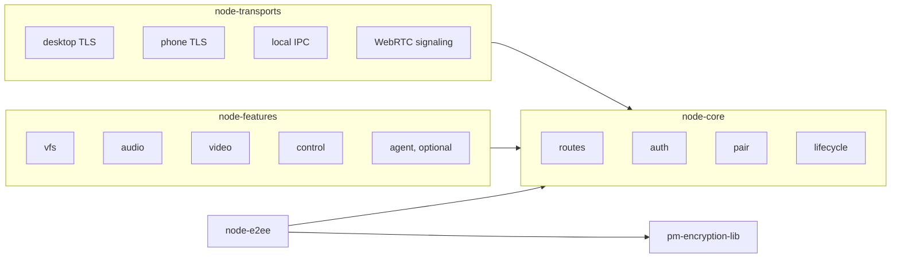
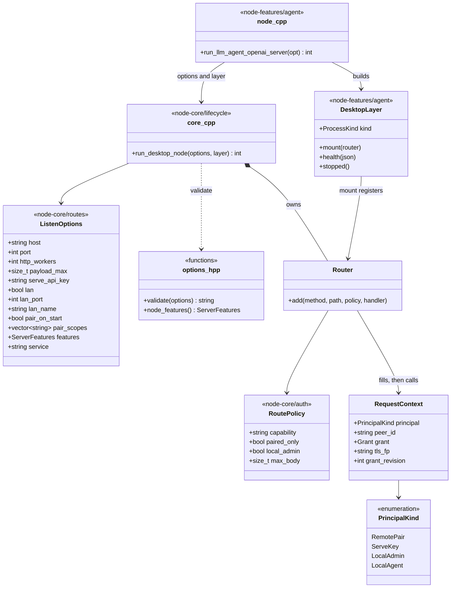
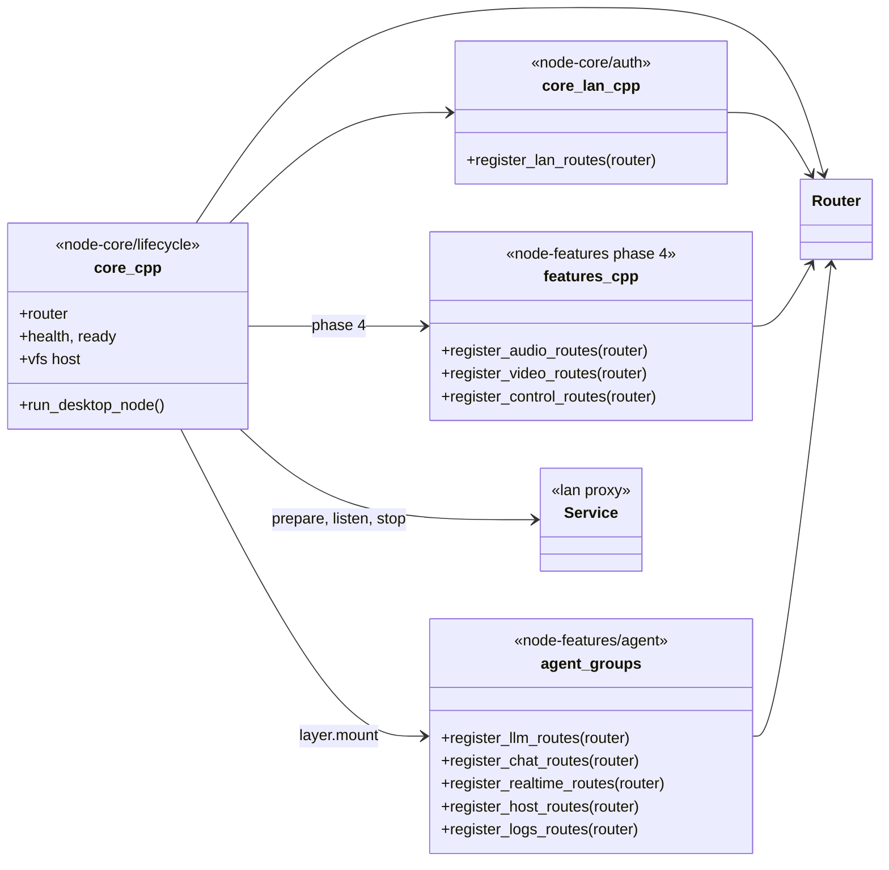
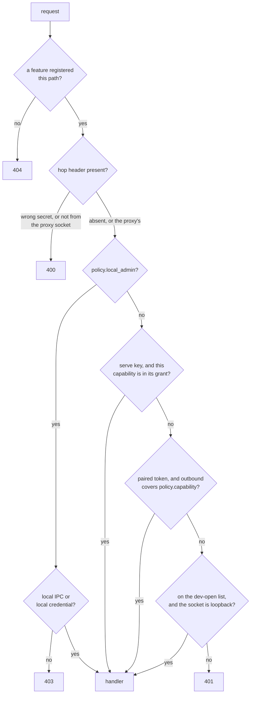
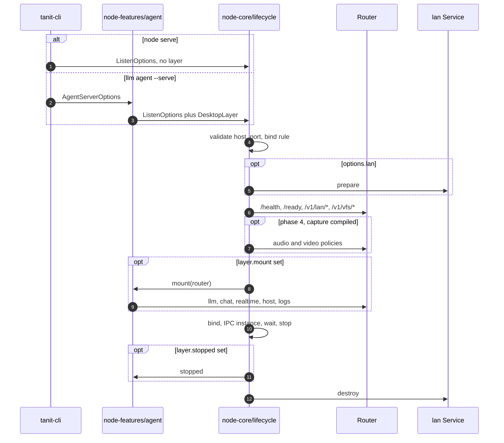
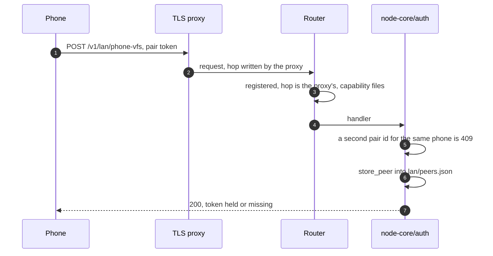

# Node after the split

**Date:** 2026-11-19  
**Status:** target in progress. `tanit-cli node serve` listens with lan and vfs, service name `tanit-node`, and does not mount the agent. An unknown `/v1/` path is 404. Loopback with no credential is refused. Pairing admin needs the serve key on the local machine. `POST /v1/lan/phone-vfs` accepts a paired device whose grant has `files`. A ticket offers only scopes whose feature is on. Audio and video still include the agent header. The phone listener keeps its own three checks. The viewer preset still leaves `FEATURE_COMMAND_NODE` off.  
**Reads with:** [node-today.md](node-today.md) (what compiles now), [node-impl.md](node-impl.md) (the commits).

One listener function, in `node-core`. It is everything a node is with `llm` off. Features register routes on a router the core owns. They do not receive `httplib::Server`, and they do not answer their own auth. Phone TLS is phase 1 and lands before this split.

## 1. Folders

Four directories inside this package. They are not new packages. Public headers stay `pm/server` and `pm/node`. A caller does not include a `node-core/` path.

`packages/encryption.cpp` is not one of the four. It does not include this package, and this package does not include it except from `node-e2ee`.

```text
packages/server.cpp/src/
  node-core/
    routes/          router, dispatch, ListenOptions. Which feature is mounted
    auth/            RoutePolicy check. Hop, serve key, paired token, local admin
    pair/            PairStore. The pair file, the token hash, the grant
    lifecycle/       run_desktop_node, the phone listener, startup and shutdown
  node-transports/
    desktop/         Schannel proxy, mDNS. The TLS listener a phone dials today
    phone/           TLS in front of the phone listener. Phase 1
    ipc/             Turns a host IPC caller into local_admin. The IPC server stays outside
    webrtc/          Signaling only, when a media path exists. No files until then
  node-features/
    vfs/             /v1/vfs, bookmark roots
    audio/           /v1/audio. Phase 4
    video/           /v1/video except /control. Phase 4
    control/         /v1/video/control. Off on the phone. Phase 4
    agent/           llm, chat, realtime, host, logs. FEATURE_COMMAND_LLM only
  node-e2ee/         Phase 5. Links pm-encryption-lib. node serve does not compile it

packages/encryption.cpp/
  library, tests, vectors
  no include of server.cpp
```

| Today | Lands in |
|---|---|
| `base/src/vfs.cpp`, `vfs.hpp`, `vfs_root.hpp` | `node-features/vfs`. Still in `pm-server-lib`, because the phone mounts it |
| `vfs_bookmarks.cpp` | `node-features/vfs`. Host-compiled. It reads the settings store |
| `peer/pair_store.cpp`, `lan/pair_store.hpp` | `node-core/pair` |
| `peer/listener.cpp` | `node-core/lifecycle`. The phone process. TLS sits in front of it |
| `base` headers `features.hpp`, `secret.hpp` | `node-core/routes` |
| `desktop/node.cpp` listen, gate, `/health`, vfs host | `node-core/lifecycle/desktop.cpp`. Host-compiled |
| `desktop/node_lan.cpp` except `/v1/logs` | `node-core/auth/lan.cpp` |
| `desktop/node_internal.hpp` helpers, `g_lan` | `node-core/auth`. No `llm/` include |
| `desktop/lan_win.cpp`, `lan_stub.cpp`, `lan_qr.cpp`, `mdns_*` | `node-transports/desktop` |
| `android/vfs_listener.cpp` | `node-transports/phone` |
| `android/node.cpp` | `node-core/lifecycle`. The phone feature flags |
| `desktop/node_audio.cpp` | `node-features/audio`. Phase 4. It includes the agent header until then, so phase 2 leaves the file in `desktop/` |
| `desktop/node_video.cpp` except `/control` | `node-features/video`. Phase 4, same reason |
| `POST /v1/video/control` inside `node_video.cpp` | `node-features/control`. Phase 4 |
| `desktop/node.cpp` completion gate, `node_llm.cpp`, `node_chat.cpp`, `node_realtime.cpp`, `node_host.cpp` | `node-features/agent` |
| `/v1/logs` in `node_lan.cpp` | `node-features/agent/node_logs.cpp` |
| command IPC in the host | stays there. `node-transports/ipc` is the adapter that marks the caller `local_admin` |
| — | `node-transports/webrtc`. No file until signaling is a route on the router |
| — | `node-e2ee`. No file until phase 5 |



Nothing points at `packages/encryption.cpp` except `node-e2ee`. `node serve` links `node-core`, `node-transports/desktop`, `node-transports/ipc`, and `node-features/vfs`. Phase 4 adds audio, video, and control when the binary has them. It does not link `agent`, `webrtc`, or `node-e2ee`.

`pm-server-lib` is the portable slice: `node-core/pair`, `node-core/lifecycle/listener.cpp`, `node-features/vfs`, and `node-core/routes` once the phone uses the same gate. `node-core/lifecycle/desktop.cpp` stays host-compiled. It includes the desktop transport and the settings store.

Phase 2 first adds the interfaces and CMake source ownership at the current paths. It then moves into `node-core` and `node-features/agent`, plus `node-transports/desktop` and `node-transports/ipc`, before switching to the router gate. It does not move audio, video, or control. Phase 1 has already added `node-transports/phone` in front of the listener that still lives at `peer/listener.cpp` until this move.

## 2. Classes

### Options, the router, and the layer



`node_features()` is `lan` and `vfs`. Phase 4 adds `audio` and `video` when the binary has capture. `payload_max` is 9 MiB on `node serve`. The agent still passes a 500 MiB ceiling for its own process. `service` is `tanit-node`, or `tanit-llm-agent` when the layer is on. `RoutePolicy.max_body` is the per-route cap. Phase 4 is what makes the vfs cap and the completion cap different routes rather than one process number.

`capability` is `files`, `audio`, `video`, `chat`, or `tools`. Empty means any paired peer. `layer.scope` is not a field. `RemotePair` comes from a paired token. `ServeKey` comes from the configured serve credential and its explicit grant. `LocalAdmin` comes from IPC or a local credential. `LocalAgent` is injected only by a direct in-process call and carries explicit capabilities plus consent. Neither local principal is inferred from loopback.

### Who registers what



`node-core/lifecycle/desktop.cpp` includes the desktop transport header and the settings store through `node-features/vfs` bookmarks. It includes nothing from `llm/`. It is not in `pm-server-lib`.

## 3. Gate

The router runs this before the handler. The handler still checks the object: this mount, this path, this stream.



The dev-open list is empty unless a build names routes. Pairing admin, vfs, audio, video, and host tools are not on it. A new route is not on it unless someone adds it.

Against the gate in [node-today.md](node-today.md):

- One check for vfs and for every other group. The vfs `authorize` callback stops being a second copy.
- An unknown `/v1/` path is 404. It is not the `llm` feature.
- A paired device with `files` may call `POST /v1/lan/phone-vfs`.
- Loopback with no credential is not a pass. The hop is not a capability.
- The serve key only covers the capabilities named at startup.
- The phone listener grows the same policies in phase 3. Until `node-core/routes` exists, `peer/listener.cpp` keeps its three checks.
- A ticket offers only scopes whose feature is on.
- A streaming handler registers peer id, capability, grant revision, and a cancellation handle. Revoke or grant narrowing closes matching streams and sessions. An upload rechecks the revision while consuming chunks and removes a partial file when cancelled.

Status codes and bodies of registered routes do not change. With the agent layer on, `/health` stays byte-compatible.

## 4. Sequences

### Start



A non-loopback bind still needs a serve key. `validate_server_options` calls `pm::server::validate`. `node serve` and `llm agent --serve` share the port, the TLS identity, `devices.json`, and the mDNS name. The second process fails at bind.

### A phone announces to a plain node

This fails today with 403. It is the viewer case.



## 5. Before and after

| | Today | Target |
|---|---|---|
| Desktop listener | `run_llm_agent_openai_server` | `run_desktop_node`. The agent function wraps it |
| Compiled when | `FEATURE_COMMAND_LLM` | `FEATURE_COMMAND_NODE` or `FEATURE_COMMAND_LLM` |
| In `tanit-viewer` | No | Yes, phase 2 |
| Gate | A closure in `register_routes`, and a second copy for vfs | `Router`, one policy per route. The phone joins it in phase 3 |
| Unknown `/v1/` | Treated as `llm` | 404 |
| Open loopback | Pass when no serve key and no hop | Not a pass. A named dev-open list is the only exception |
| Phone announce | Serve key only | A pair token with `files` |
| `/health` service | `tanit-llm-agent` | `tanit-node`, or the agent's name when the layer is on |
| Body limit | 500 MiB for the process | 9 MiB on `node serve`. `RoutePolicy.max_body` per route in phase 4 |
| `/v1/logs` | `desktop/node_lan.cpp` | `node-features/agent`. 404 on a plain node |
| Audio, video, control | `desktop/node_audio.cpp`, `node_video.cpp` | `node-features/audio`, `video`, `control`. Phase 4. Control stays off on the phone |
| Desktop pair file | Ticket scopes in `lan_win.cpp` | `node-core/pair` in phase 3. `PairStore` rows |
| Device id | TLS key on the desktop, random hex on the phone | The id stays a label. The TLS pin is the field. A long-term key is not assumed |
| Agent files | `desktop/node_*.cpp`, one include of the agent | `node-features/agent`. `node-core` has no `llm/` include |
| Transports | Desktop proxy in `lan_win.cpp`. Phone is cleartext. IPC is outside | `node-transports/desktop`, `phone`, `ipc`. `webrtc` stays empty until signaling is a route |
| `encryption.cpp` | Not linked. No include of this package | Stays that way. Only `node-e2ee` links it, and `node serve` does not |
| CLI | `llm agent --serve` | The same, plus `node serve`, `node devices`, `node revoke` |
