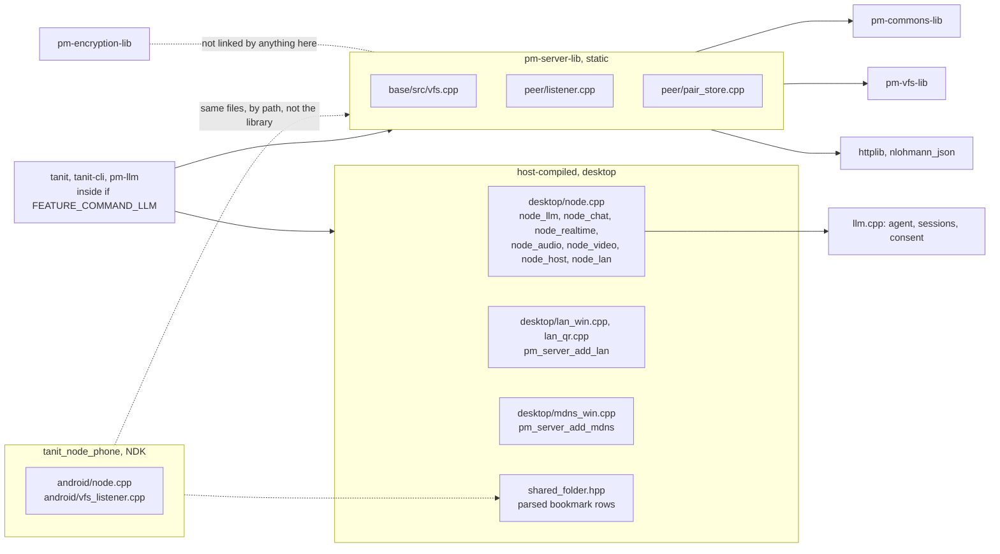
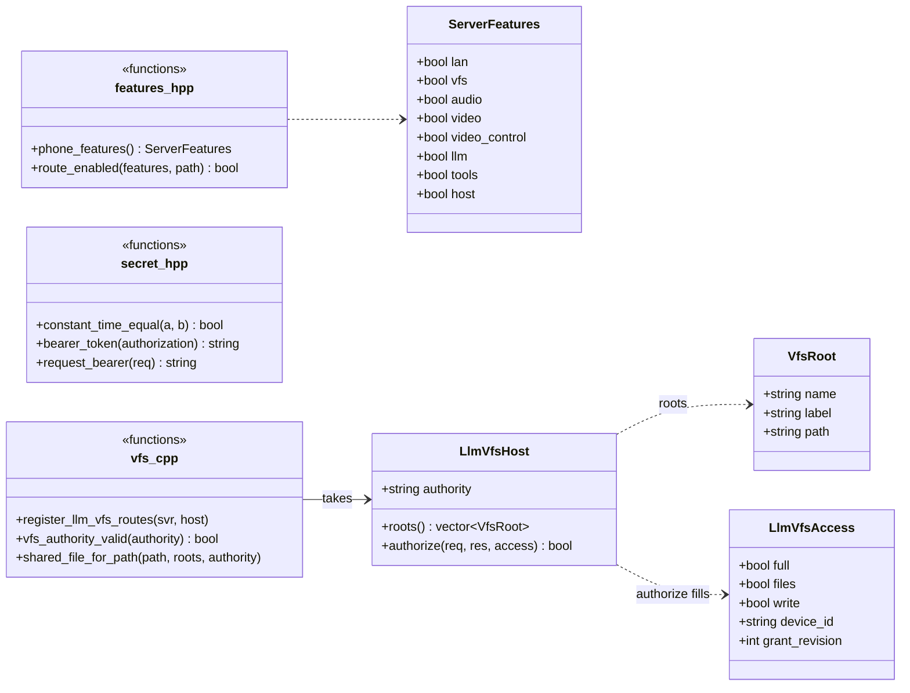
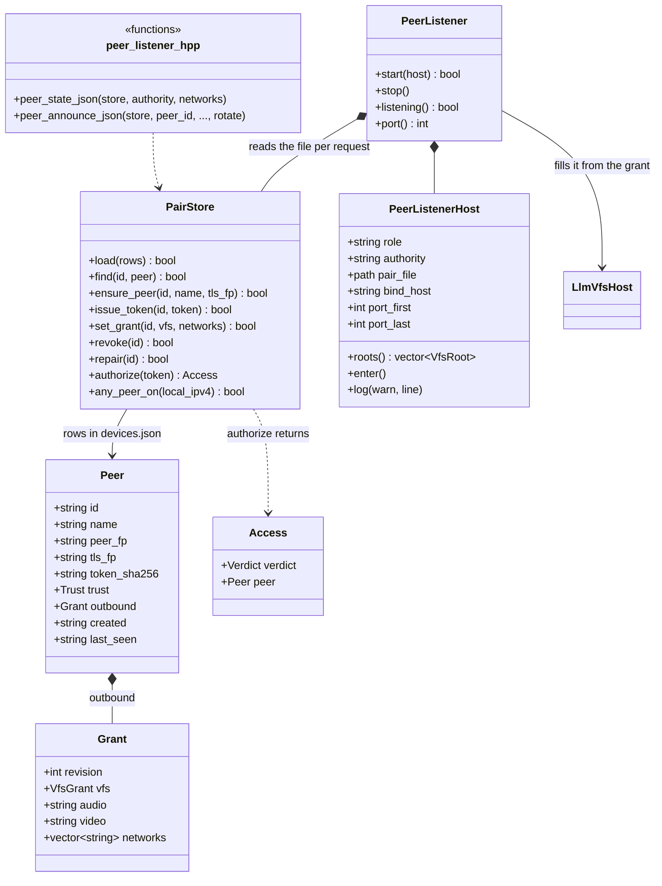
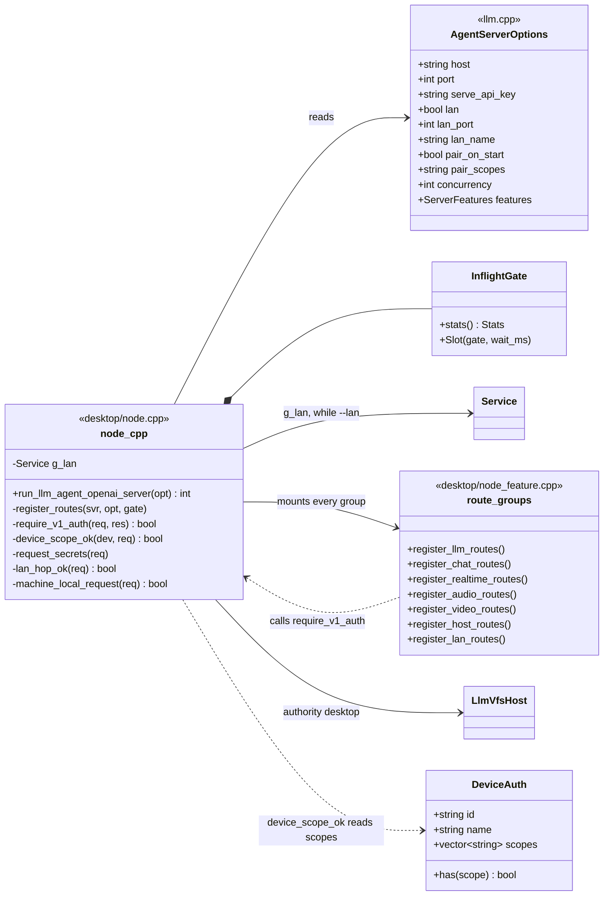
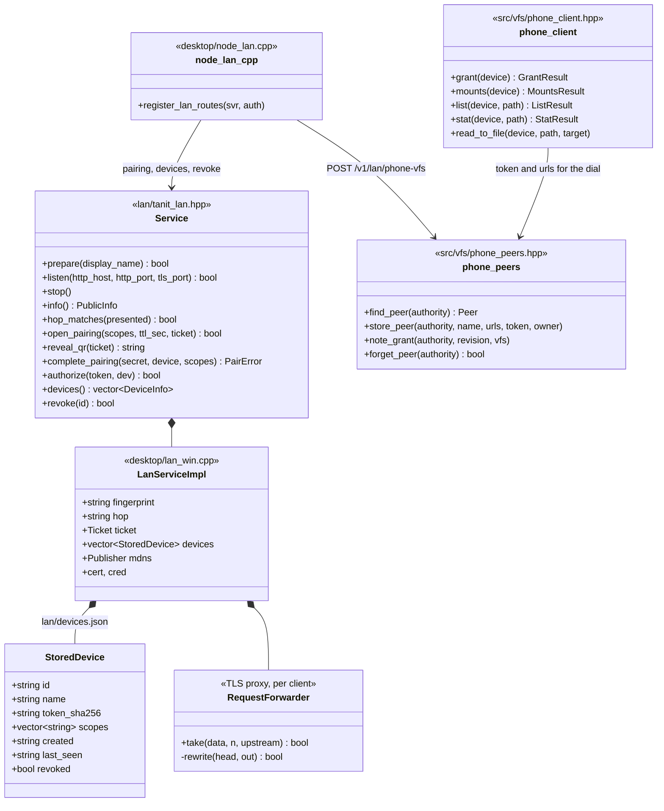
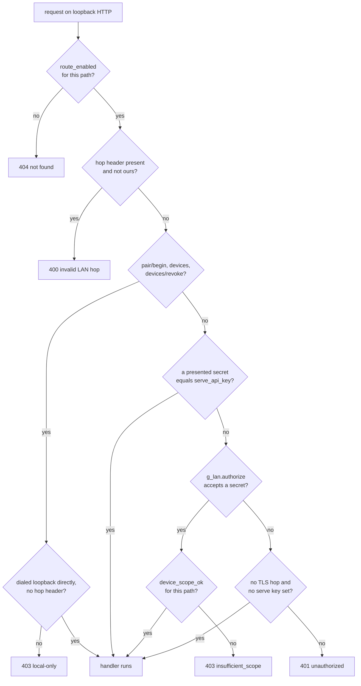
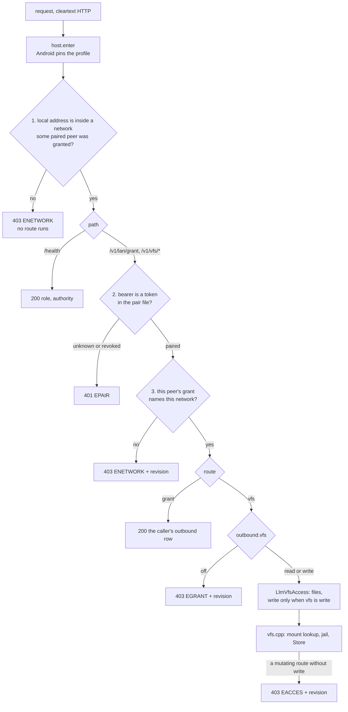
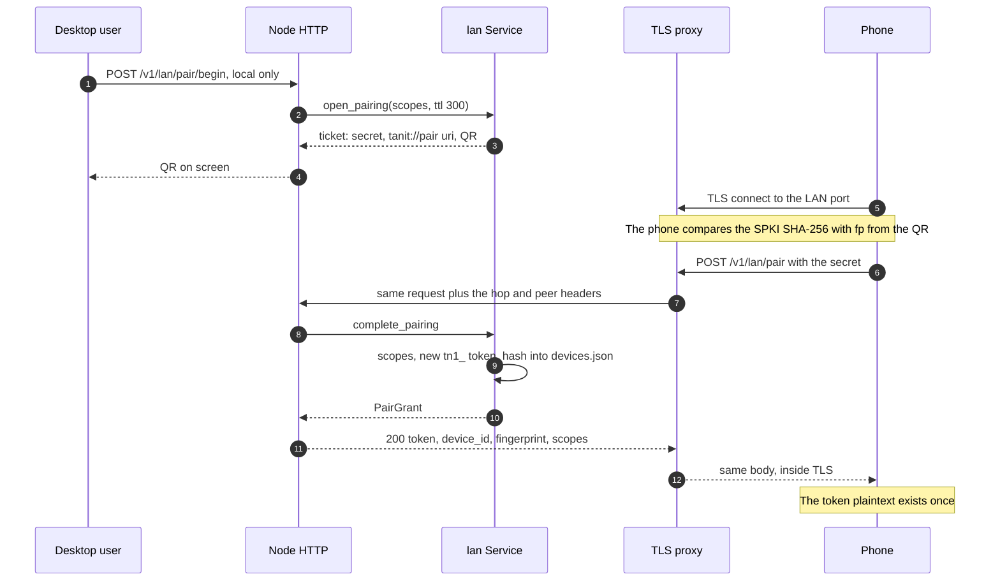
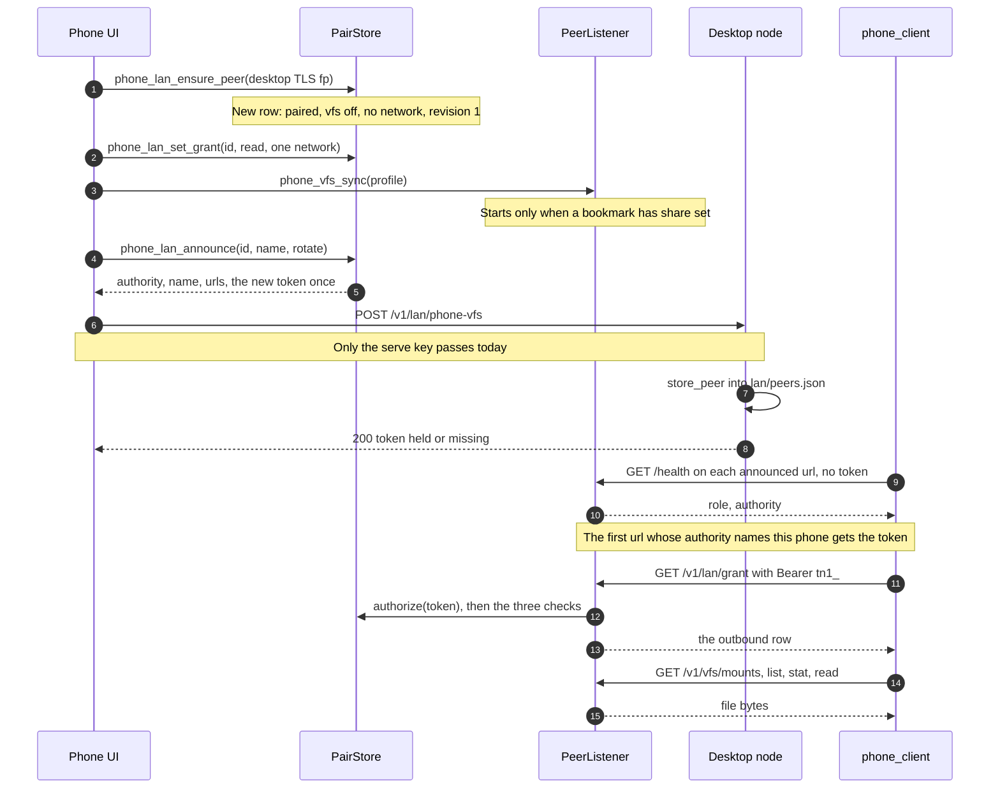

# Node today

**Date:** 2026-11-19  
**Status:** the code as it compiles now. The planned split is [node-refactor.md](node-refactor.md). Where `encryption.cpp` meets these types is [encryption-seams.md](encryption-seams.md).  
**Reads with:** [README](../README.md) (module index), [docs/tanit-mesh.md](../../../docs/tanit-mesh.md) (design and todos).

Two listeners exist. They share the vfs route table and nothing else.

| | Desktop listener | Paired-peer listener |
|---|---|---|
| Entry | `run_llm_agent_openai_server` in `desktop/node.cpp` | `pm::node::PeerListener` in `peer/listener.cpp` |
| Runs | On the desktop, only inside `llm agent --serve` | On the phone today. The file is portable |
| Transport | HTTP on loopback. A Schannel proxy in front of it for the LAN | Cleartext HTTP on `0.0.0.0`, first free port from 8092 to 8100 |
| Caller is known by | The serve key, a `tn1_` token in `lan_win.cpp`, or open loopback | A `tn1_` token in `PairStore` |
| What a peer may do | Ticket scopes, fixed at pairing: `chat`, `files`, `tools`, `video`, `audio` | The `outbound` grant row. Editable, with a revision |
| Pair file | `lan\devices.json`, `StoredDevice` rows | `lan/devices.json`, `pm::lan::Peer` rows |
| Routes | Every group | `/health`, `/v1/lan/grant`, `/v1/vfs/*` |

Both pair files are named `devices.json`. They are two schemas written by two different files.

## 1. Who compiles what

A build with `FEATURE_COMMAND_LLM` off links none of this. That is why `tanit-viewer` cannot be told about a phone folder.

## 2. Classes

### Portable: the route table and the feature flags

`base/`. No environment, no settings store, no agent.

The routes read no settings. The node names itself in `authority` and supplies the folders and the authorize callback.

### Portable: the pair file and the paired-peer listener

`peer/`.

`Peer.peer_fp` is in the row and nothing writes it. `Trust` is `Verifying`, `Paired`, or `Revoked`. `VfsGrant` is `Off`, `Read`, or `Write`. `audio` and `video` are stored strings that no route checks yet.

### Desktop: the listener and the gate

`desktop/node.cpp` and the route files.

Every `node_*.cpp` includes `node_internal.hpp`, and that header includes the agent, the chat plugin, consent, and the session store.

### Desktop: the LAN service and the dial side

`desktop/lan_win.cpp`, and two files outside this package.

`phone_peers` and `phone_client` are the dial side. They are in `src/vfs`, in every build.

## 3. Request flow

### Desktop gate

`require_v1_auth` is a closure inside `register_routes`. Each handler calls it first.

Three things do not go through that closure:

- `/health` and `/ready` have no check.
- `GET /v1/lan/info` has no check. `POST /v1/lan/pair` runs its own hop test and then the ticket.
- The vfs group has its own `authorize`, built in `register_routes`. It repeats the hop, serve key, token, and open-loopback steps and asks for `files`.

None of those three consult `route_enabled`. Setting `features.vfs` or `features.lan` to false does not turn those paths off on the desktop.

`device_scope_ok` ends in `return false`. A path with no row is refused for every paired device. `POST /v1/lan/phone-vfs` has no row.

### Paired-peer listener

Three checks, on the device that owns the folders. `PairStore` reads the file on every call, so an edit applies to the next request.

`ServerFeatures` is not consulted per request here. `android/vfs_listener.cpp` checks `android_listener_features().vfs` once, before it starts the listener.

## 4. Sequences

### A phone pairs with a desktop

The body of step 6 is the secret, `device_id`, `device_name`, and the scopes the phone asks for. The stored scopes are the offered ones intersected with those. The proxy drops any `X-Tanit-Lan-Hop` or `X-Tanit-Lan-Peer` header the client sent and writes its own. The node treats a request as a phone when the hop header matches. Eight wrong secrets lock the ticket for 30 seconds.

### A phone shares a folder, and the desktop reads it

The first three participants are on the phone. Kotlin calls them over JNI. The last two are on the desktop.

Step 6 goes through the desktop TLS proxy. A pair token is refused there because `device_scope_ok` has no row for that path.

Everything `phone_client` sends is cleartext HTTP. The token and the file bytes are readable on that network. The address that receives the token is chosen by an unauthenticated `/health` answer.

## 5. State on disk

| File | Device | Written by | Holds |
|---|---|---|---|
| `lan\identity.json` | Desktop | `lan_win.cpp` | SPKI SHA-256 of the RSA key in container `TanitLanIdentity.rsa.v1`. A change revokes every device row |
| `lan\devices.json` | Desktop | `lan_win.cpp` | `StoredDevice`: id, name, token hash, ticket scopes, revoked. At most 64 |
| `lan\peers.json` | Desktop | `src/vfs/phone_peers.hpp` | Phones this computer may dial: authority, urls, the phone's token wrapped by secure storage, cached grant |
| `lan/devices.json` | Phone | `peer/pair_store.cpp` | `Peer`: id, name, `peer_fp`, `tls_fp`, token hash, trust, `outbound`. At most 16 |
| `phone-node-id` | Phone | `android/vfs_listener.cpp` | `phone-` plus 16 random hex. The vfs authority |

In memory only: the pairing ticket, the hop secret, the `InflightGate` counters. No Ed25519 key exists on either side.
