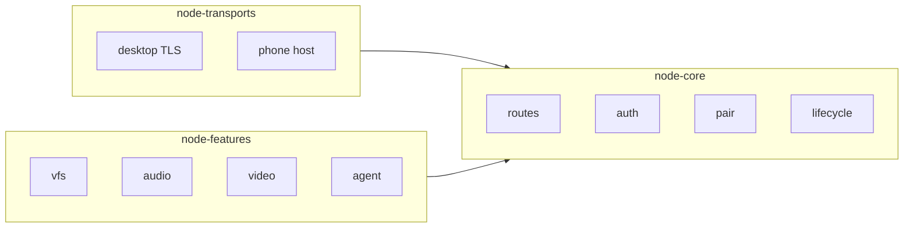
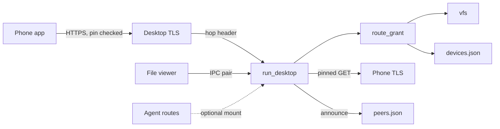
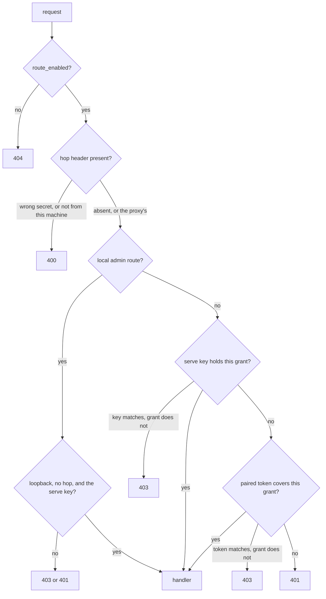

# Node

**Date:** 2026-11-19  
**Status:** this is the layout. `node serve` listens with lan and vfs. The agent is the same listener plus its own routes. The viewer preset leaves `FEATURE_COMMAND_NODE` off.

Public headers stay `pm/server` and `pm/node`. A caller does not include a `node-core/` path. `packages/encryption.cpp` is not linked, and this package does not include it.

The explorable map is [node-architecture.html](node-architecture.html).

## Folders

Four directories. They are not packages.

```text
packages/server.cpp/src/
  node-core/
    routes/          node serve mounts health, lan, vfs, presets, and capture
    auth/            route_grant. Hop, serve key, paired token, local admin
    pair/            PairStore. devices.json, the token hash, the dial row
    lifecycle/       run_desktop, the phone listener, its TLS splice, sessions
  node-transports/
    desktop/         Schannel proxy, mDNS, the pairing QR
    phone/           The Android host of the phone listener
  node-features/
    vfs/             /v1/vfs and the shared-folder rows
    audio/           /v1/audio, when the binary has capture
    video/           /v1/video. video_control stays off on node serve and on the phone
    agent/           llm, chat, realtime, host, logs. FEATURE_COMMAND_LLM only
```

There is no `node-transports/ipc`, no `node-transports/webrtc`, no `node-features/control`, and no `node-e2ee`. Command IPC stays in the host. `run_desktop` treats a `pair` action on that socket as local admin. WebRTC is not a route. Video control is a feature flag, not a directory. The phone's public TLS is `node-core/lifecycle/listener_tls.cpp`, in front of httplib on `127.0.0.1`.



`node serve` links core, the desktop transport, vfs, and audio and video when those features compile. It does not link the agent. `pm-server-lib` carries the pair file, the phone listener, vfs, and the route grant. `lifecycle/desktop.cpp` stays on the host. It includes the desktop transport and does not include `llm/`.

## Two listeners

One function binds the desktop, `run_desktop`. The caller registers routes. `node serve` passes lan, vfs, the desktop preset list, and capture. `llm agent --serve` passes that surface plus the agent routes. Both use the same TLS identity, `devices.json`, the mDNS name, and the default port. A second process fails when the port is already taken. On Windows a loopback bind and a wildcard bind can share the port number, so the proxy dials a LAN address this process owns.

The phone listener is `PeerListener`. httplib binds `127.0.0.1`. mbedtls terminates TLS on each granted address. The splice inserts `X-Tanit-Arrived` and the grant uses that address. A missing pin is a refusal.



`devices.json` is the pair row: `tls_fp`, `urls`, `dial_token`, and `token_sha256`. The device id is a label. The TLS pin is a separate field. `peers.json` is the desktop book of phone folders. An announce writes that book and, when the caller is a paired device, the dial row.

Places asks the agent for a ticket when the agent is up, otherwise the node. The file viewer shows the QR. The phone Scan button, next to Discover, reads `tanit://pair`. The secret is sent only after the pin matches.

## What a process mounts

| Process | Mounts | Does not mount |
|---|---|---|
| `node serve` | `/health`, `/ready`, `/v1/lan/*`, `/v1/vfs/*`, `GET /v1/models` as the desktop preset list, audio and video when compiled | `/v1/chat/completions`, tools, host, video control |
| `llm agent --serve` | The node surface, plus llm, chat, realtime, host, and logs | video control on a phone |
| Phone listener | `/health`, the grant route, `/v1/vfs`, `POST /v1/lan/phone-vfs` | llm, tools, host, video control |

`GET /v1/models` on `node serve` requires a paired token or the serve key. Chat completions stay unregistered. The agent's `/health` service name stays `tanit-llm-agent`. The node's is `tanit-node`.

The body limit is 9 MiB on `node serve` and on the phone. The agent process keeps 500 MiB on its own listener. A vfs write over 8 MiB is refused. `video_control` is off on `node serve` and on the phone.

## Gate

`route_enabled` runs first. A `/v1/` path this process did not enable is 404, including for the serve key. The handler still checks the object: this mount, this path, this stream.



Loopback without a credential is not a pass. The hop is not a capability. The serve key covers only the capabilities named at startup: files, and audio and video when those features are on. The agent adds chat and tools. A ticket offers only scopes whose feature is on.

On the phone the order is the network, then `route_enabled`, then the bearer, then the grant. A peer that was not granted the arrival network is 403 before any route runs. The serve key is not a phone credential.

Revoke, and a files grant that gets narrower, cancel live sessions. A stream registers the peer, the capability, and the grant revision.

`/v1/lan/phone-vfs` is a files route. `/v1/models` and `/v1/lan/info` are any paired caller. `/v1/audio/*` is audio. `/v1/video/*` is video. Pairing admin (`/v1/lan/pair/begin`, device list, revoke) is the serve key on a request the proxy did not forward.
